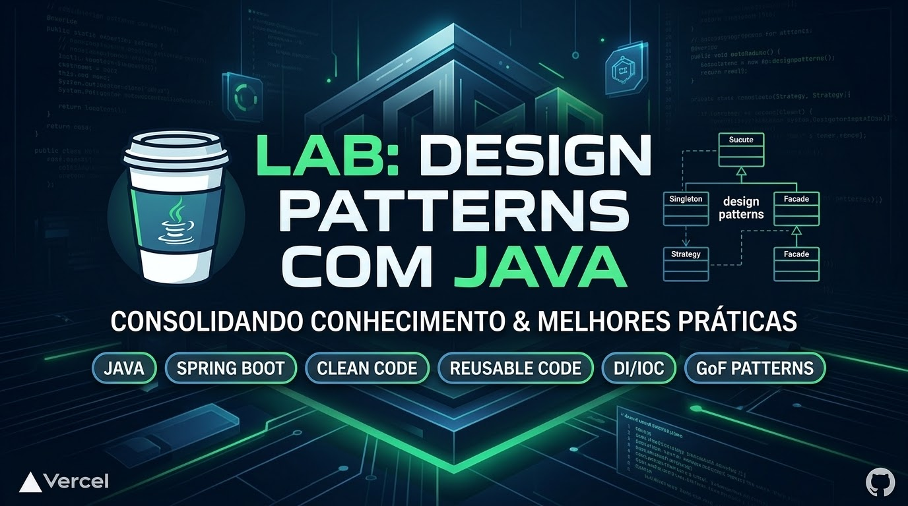

# 🚀 Design Patterns com Java & Spring Framework

---

## 📌 Sobre o Projeto

Este repositório contém a implementação prática e a landing page interativa desenvolvidas para o desafio de projeto da **Digital Innovation One (DIO)** sobre **Design Patterns com Java**.

O objetivo principal é demonstrar na prática a aplicação dos padrões de projeto clássicos do **GoF (Gang of Four)** integrados às facilidades do **Spring Framework**, entregando um código desacoplado, reutilizável e pronto para produção.

---

## 🌐 Demonstração On-line

Acesse a página do portfólio interativo construída e implantada na Vercel:

👉 **[Acessar Landing Page do Projeto na Vercel](https://design-patterns-rosy.vercel.app)**

---

## 🧩 Padrões de Projeto Implementados

- **Singleton:** Garantia de instância única para serviços do Spring (gerenciado pelo próprio container IoC/DI).
- **Strategy:** Abstração de diferentes estratégias de comportamento e regras de negócio.
- **Facade:** Interface unificada para simplificar a interação com subsistemas complexos (ex: consumo de APIs de CEP/Endereço via OpenFeign).

---

## 🛠️ Tecnologias Utilizadas

- **Java 17+** / OpenJDK
- **Spring Boot** (Spring Data JPA, Spring Web, OpenFeign)
- **Next.js / React** (Interface Web do Portfólio)
- **Vercel** (Hospedagem e CI/CD)

---

## 📚 Referências

- Repositório base do desafio na DIO: [digitalinnovationone/lab-padroes-projeto-java](https://github.com/digitalinnovationone/lab-padroes-projeto-java)

---

## 👤 Autor

Desenvolvido por **Rafael Tozato**.

---

## 📬 Contatos

- 💼 **LinkedIn:** [rafaeltozato81](https://www.linkedin.com/in/rafaeltozato81)
- 🐙 **GitHub:** [Rafael-TOZATO](https://github.com/Rafael-TOZATO)
- ✍️ **Medium:** [@ornelas.tozato](https://medium.com/@ornelas.tozato)
- 🌐 **Portfólio PWA (Dev Hub):** [tozato-dev-hub.vercel.app](https://tozato-dev-hub.vercel.app)
- 🌐 **H-Folio:** [h-folio-psi.vercel.app](https://h-folio-psi.vercel.app)
- 🚀 **Aurora BI (Lovable):** [aurora-bi-dio.lovable.app](https://aurora-bi-dio.lovable.app)
- 📜 **Microsoft Learn:** [Transcript](https://learn.microsoft.com/pt-br/users/rafaelornelastozato-2209/transcript/dzo2wizrzkx2853)
